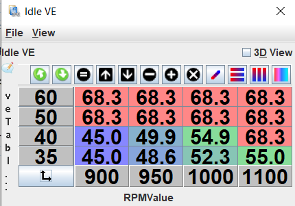

# Idle Specific VE Table

The idle VE table is a small 4x4 VE table used in place of the main VE table while the engine is idling. The engine is under very little load at idle, so small changes in load have a big effect on the AFR. These loads come from the A/C compressor engaging, or from the alternator working harder for cooling fans, headlights or even electric windows. A table dedicated to the narrow idle RPM and load range lets you tune the idle close to the AFR target whatever the load.

Turn it on with **Use idle VE table** in the **Extra Idle Features** panel under **Idle > Idle settings**. The table is then listed as **Idle > Idle VE**.

## How it works

The idle VE table is used in the speed density and alpha-N fuel modes, whenever the idle controller says the engine is idling (phase 1 in **Idle: Phase**, see [Idle Settings](/Basic-Features/Idle-Control/Idle-Settings#idle-phases)). With **Use idle tables for cranking taper** on, it's used during the crank-to-idle taper as well.

It's blended with the main VE table by throttle (or pedal) position:

- up to half of **TPS threshold**, the idle table is used alone,
- between half the threshold and the threshold, it blends linearly into the main table,
- at the threshold and above, the main table is used.

So a slight touch of the pedal while still idling doesn't jump straight from one table to the other. If the throttle position (or pedal) sensor has failed, the idle table isn't used. Any VE blend tables still apply on top of the result.

| Axis | Units | Description |
| --- | --- | --- |
| RPM | RPM | Engine speed, 4 points |
| load | load | The same load the main VE table uses (MAP in speed density, TPS in alpha-N), unless **Override Idle VE table load axis** is set. 4 points |

**Override Idle VE table load axis** can change the load axis for this table only. **None** uses the same load as the main VE table, **MAP** uses manifold pressure, and **TPS** uses throttle position. If you aren't sure you need this, leave it on **None**.

Both axes must be in ascending order, or the ECU raises a configuration error.

## Setup

To tune the idle VE, make sure closed loop fuel correction is turned off. Warm the car up and switch off all cooling fans, headlights and air conditioning. Tune the idle VE table cells being used until the AFR target is reached.

Now turn on the accessories one by one, tuning the cells the idle VE table moves into. Then repeat this with several accessories on at once, such as the air conditioning and headlights. Once the cells have been tuned, interpolate to fill any unused cells and smooth the cells together. If engaging the accessories has a large effect on the AFR, you may not be able to smooth the table much.

## Related

- [Idle Settings](/Basic-Features/Idle-Control/Idle-Settings)
- [Advanced Idle](/Basic-Features/Idle-Control/Advanced-Idle#idle-tables-for-cranking-taper)
- [Closed Loop Fuel](/Advanced-Features/Fuel-Related/Closed-Loop-Fuel)
