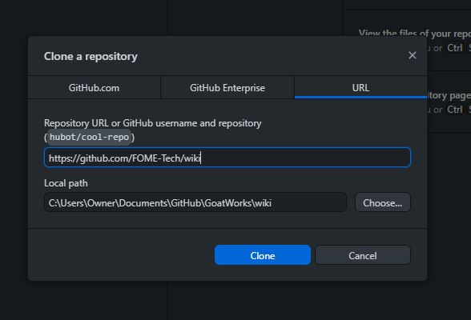
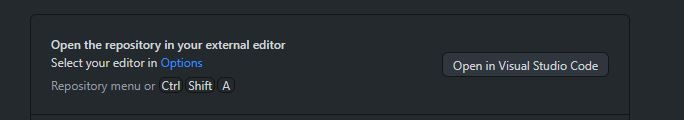
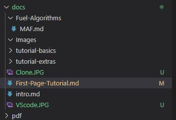
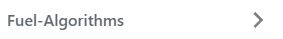
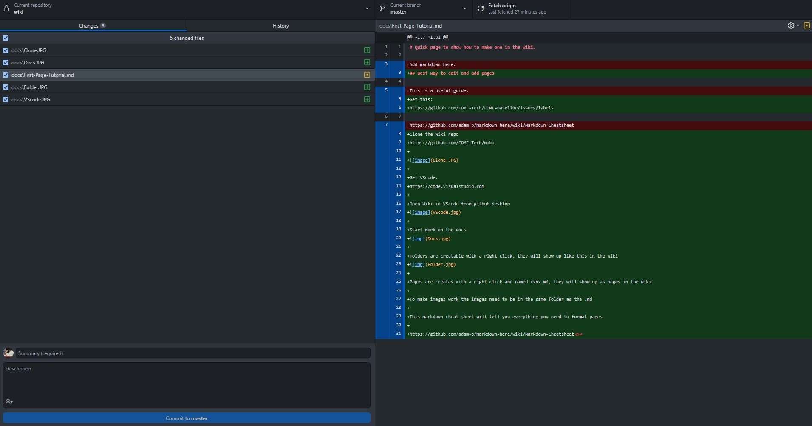
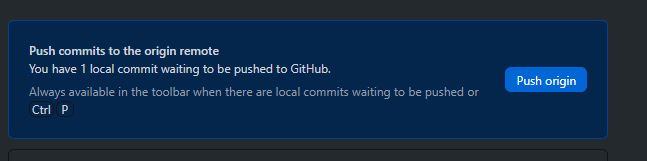

# How to add, change and test a page in the wiki

## Prerequisites

- A free login in GitHub

## Simplest approach to make a small change

- go to end of page and click on "Edit this page" link
- follow GitHub's instructions for ["Editing files in another user's repository".](https://docs.github.com/en/repositories/working-with-files/managing-files/editing-files#editing-files-in-another-users-repository)

## Our recommended way to edit or add a larger number of pages

Get this:
[Github Desktop](https://desktop.github.com)

Clone the wiki repo
[Wiki Repo](https://github.com/FOME-Tech/wiki)



Get VScode:
[VSCode](https://code.visualstudio.com)

Open Wiki in VScode from github desktop


On your left by default, you will see your explorer sidebar. If you do not see it, hit **CTRL + SHIFT + E**


To control ordering of topics in sidebar navigation the so called "numbered prefix" concept is used.
This concept is further explained in [linked section of Docusaurus user manual](https://docusaurus.io/docs/sidebar/autogenerated#using-number-prefixes)

Pages and folders are created by right-clicking empty space in the explorer and should be named "##-xxxx.md" according to the link directly above. You fill in the "##" for a page/folder number and "xxxx" for what the page/folder is about. This way they will show up correctly in the wiki. For example, this is how folders how up in the wiki:



To make images work, the images need to be in the same folder as the .md file you've created. Image names are also case sensitive. As an example, look inside of the explorer sidebar again. You can see that this **"98-How-to-edit-wiki.md"** and **"Folder.JPG"** are within the same **"docs"** folder. That is how the **"Fuel-Algorithms"** picture above is able to be called for use.

[Here is the guide for formatting the text](https://github.com/adam-p/markdown-here/wiki/Markdown-Cheatsheet)

## How to test your changes

### Prerequisites for local test

- [Node.js](https://nodejs.org/en/download/) version 18 or above:
  - When installing Node.js, you are recommended to check all checkboxes related to dependencies.

### Run Docusaurus locally by

Opening a terminal or command prompt and navigating to the cloned wiki directory:

```bash
cd C:\Users\User\Documents\GitHub\wiki
```

Install NodeJS dependencies:

```bash
npm install
```

Run the development server:
*After you run this, your browser should automatically open a page to [http://localhost:3000](http://localhost:3000)*

```bash
npm start
```

---

**The `cd` command changes the directory you're working with. In order to work with your newly created Docusaurus site, you'll need to navigate the terminal there**

 **The `npm install` installs all the dependencies for your site. You'll need to run this command once when you first download the project, and again only if you `package-lock.json` file changes**

 **The `npm start` command builds your website locally and serves it through a development server, ready for you to view at [http://localhost:3000](http://localhost:3000)**

 **Open `docs/98-How-to-edit-wiki.md` (this page) and edit some lines: the site **reloads automatically** and displays your changes after hitting save**

---

### How to publish your change to wiki

Open github desktop again, and hopefully you'll see all of the changes you've made.

It will ask you for a summary of your changes, more thorough description, and to commit the changes (see bottom left of picture)



 Most likely, you do not have the permissions to edit the wiki directly, so at the bottom left you will be prompted to **"create a fork."** Click that, then **"Fork this repository,"** and **"To contribute to the parent project."** **"Commit to master"** should now be able to be clicked. Once you do, you will be directed back to the main screen and near the top you'll then see this following prompt.



**Pushing** in this context means to save your changes to your saved copy of the wiki repo (short for repository). Once you do this, the next prompt will be to **"Preview Pull Request."** Click the down-arrow to the right of it and instead click **"Create Pull Request."** As the text beside it shows, you "Create a pull request to propose and collaborate on your changes." In other words, this makes a request for the maintainers of the wiki to review your suggested changes. Once approved, the true wiki repository will **pull** from your local **push** and be accepted into the master repository and the live wiki pages will now have your edits. Even more simply, your "pull request" is another way to say "I want the *actual* wiki to download the changes I made to the copy of it I made that are saved locally on my computer."

When you create a pull request, your browser should open automatically, and you'll again see a **"Title"** and **"Description"** box. These are the boxes where you quickly and more thoroughly describe your changes you've made to the wiki that the maintainers will be able to see. 

[And again, formatting assistance can be found here](https://github.com/adam-p/markdown-here/wiki/Markdown-Cheatsheet)

## Section guidelines

- **Fundamentals of tuning:** explain why things are needed, for example why an engine needs certain AFRs, why timing is reduced, what knock is, and why fuel is added on acceleration. Leave how FOME implements each feature to that feature's own page, and link between the two. Keep these pages as short introductions, which also head off many common user questions.
- **Hardware circuits:** describe the generic driver layouts, what each one is and the basics of how it works.

## Feature page conventions

Pages that document a firmware feature or sensor (the "how" pages) follow a common layout, so readers know where to find things. The Fundamentals of tuning pages are the "why" layer and don't follow it. Feature pages link to them instead of repeating the theory. [Coolant Temperature](/Sensors-And-Gauges/Temperature-Sensors/CLT) is a good example to copy.

### Layout

Use these sections in this order. Leave out any that don't apply, but don't reorder them.

1. **Title and introduction.** Match the TunerStudio dialog or menu name. In two to four sentences, say what the feature does and when you need it, then where the settings are, e.g. "Settings are under **Sensors > CLT sensor**."
2. **How it works.** The behaviour at the level a tuner needs: the inputs, what's computed and what it affects.
3. **Settings.** A table of every field in the dialog (Setting, Units, Description), then a short sub-section only for settings that need more than one line.
4. **Setup.** A numbered procedure, with starting values where they mean something.
5. **Checking it works.** Which gauges and log channels to watch, and what good looks like.
6. **If it fails.** Only where the ECU does something defensive worth knowing, such as substituting a value, inhibiting a feature or setting a fault code with a specific effect. This mostly applies to sensors. Leave it out if all it would say is that a misconfigured feature doesn't work. Put setting limits in the settings table instead.
7. **Troubleshooting.** A symptom and likely-cause table.
8. **Related.** Links to related pages.

### Style

- **Exact UI names.** Write TunerStudio labels in bold, spelled exactly as TunerStudio shows them. Write menu paths as **Menu > Item**.
- **Check against the firmware.** Check every claim about what the ECU does against the firmware source when you write it.
- **No firmware internals.** Don't name files, functions or variables. The exception is output channel and gauge names, which users see in their logs.
- **Values.** Give generic starting points where they help, but don't quote firmware defaults, because they vary by board and engine type and go out of date.
- **Tooltips vs the wiki.** A tooltip says in a sentence or two what a field is. The wiki page adds the why, the interactions, the setup procedure and the pitfalls, and doesn't repeat the tooltip.
- **Units.** In the settings table, use the unit TunerStudio displays (C, kPa, ms, %, V, Ohm). In prose, write units properly with a space: 95 °C, 2.49 kΩ, 0.5 V.
- **Screenshots.** Use them sparingly, only where a picture explains something text can't, such as wiring, a log trace or a curve shape. They go out of date with every UI change.
- **Admonitions.** Use `:::warning` for anything that can damage the engine or hardware, `:::tip` for shortcuts and `:::note` for caveats.
- **Length.** As short as it can be while staying complete.

### Links and short links

- **Internal links** are absolute site paths with no number prefixes and no `.md`, for example `[Fault Codes](/Limits-And-Protections/Fault-Codes)`. `scripts/linkValidator.js` checks this.
- **TunerStudio links** to the wiki only use `/r/<slug>` short links, defined in `docusaurus.config.ts`. If you move or rename a page, repoint its short link and fix links to it from other pages. Old page URLs don't get redirects.
- **Page order** comes from number prefixes on file names. These don't appear in URLs, so renumbering is safe.

### Before you submit

From the wiki folder, run `npx markdownlint <file>` and `node scripts/linkValidator.js '<file>'` on each page you changed (run `npm ci` once first). If you moved pages or changed short links, also run `npm run build`, which checks for broken links. Table separator rows need spaces, like `| --- | --- |`.
